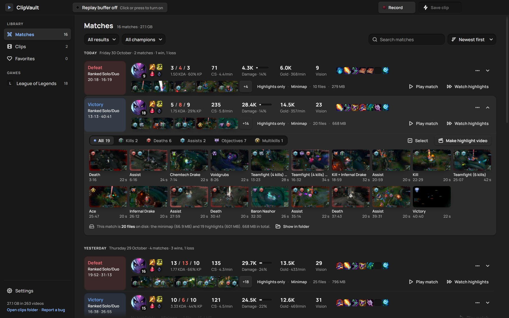
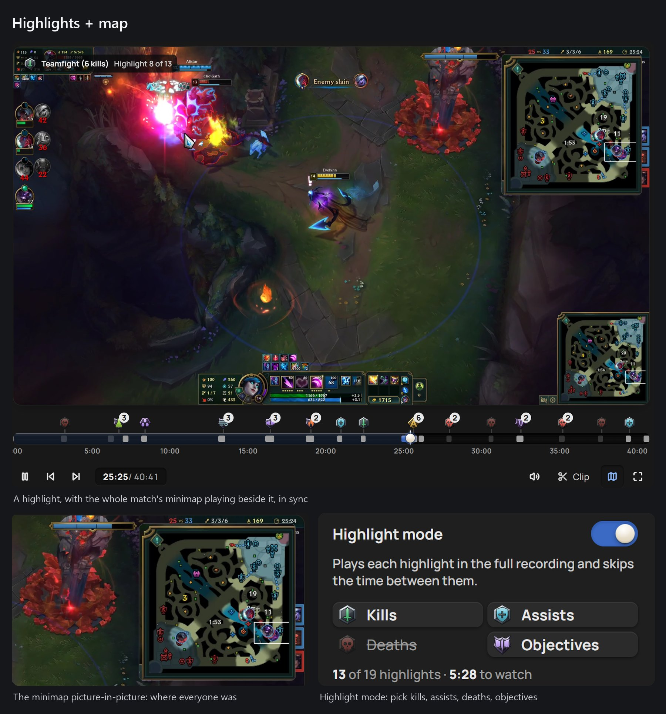
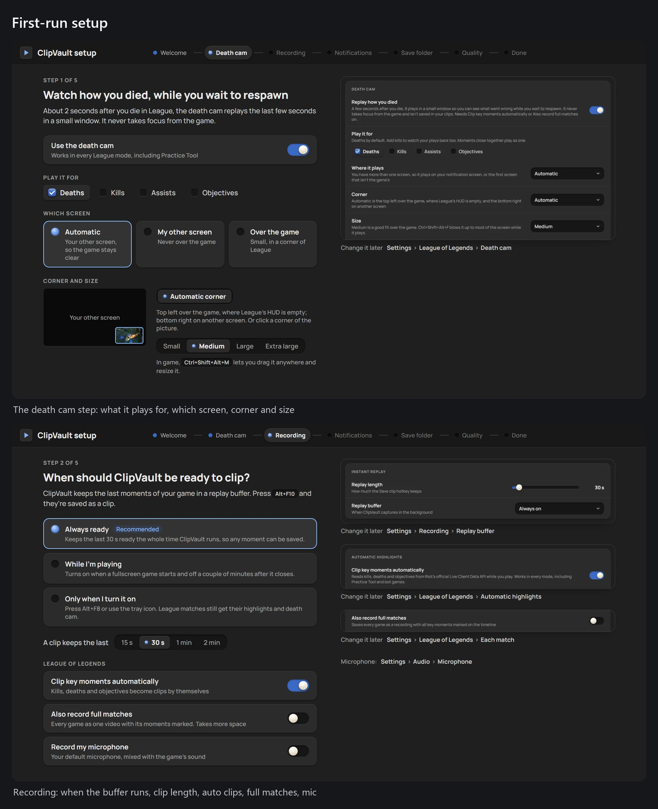

<div align="center">

# ClipVault

**The League of Legends auto-clipper without the ads, the account or Overwolf. Free and open source, for Windows.**

[**⬇ Download the installer**](https://github.com/arpan2711/clipvault-public/releases/latest) · [**⬇ Portable zip**](https://github.com/arpan2711/clipvault-public/releases/latest) · [User guide](docs/GUIDE.md) · [Report a bug](https://github.com/arpan2711/clipvault-public/issues) · [Code signing policy](docs/CODE_SIGNING.md) · [**☕ Support it**](https://ko-fi.com/arpanmitra)

[](https://github.com/arpan2711/clipvault-public/releases/latest)
[](https://github.com/arpan2711/clipvault-public/releases)

[](LICENSE)




<sub>My real Matches page. Every League game is a row with its stats; open one and its highlights are already there, clipped while I played.</sub>

</div>

---

ClipVault is my free take on Insights Capture, Outplayed, Medal and the like. It keeps the last 30 seconds of your game, saves a clip with one key, and in League it clips your kills, deaths and objectives by itself and gives every match a page with your stats. There are no ads, no account to make, no Overwolf, and nothing leaves your PC.

It also does two things I haven't found in any of the others: it **shows you how you died while you wait to respawn**, and it **records the minimap for the whole match**, so every highlight plays with the full map beside it.

It's a hobby project by one developer, made with a lot of help from an AI coding assistant. It's free, open source (MIT) and will stay free. If something breaks, [tell me](#reporting-bugs). If it's useful to you, you can [buy me a coffee](https://ko-fi.com/arpanmitra).

## The death cam


About **2 seconds after you die**, a small replay of the fight plays in League's empty top-left corner. You see what went wrong while the respawn timer runs, not after the game.
- It never takes focus from the game. Over the game, clicks go straight through to League.
- Its keys sit in a strip **under** the picture, so they never cover the replay.
- It isn't saved in your clips, and screen captures don't see it.
- With a second screen it can play there instead.


| Hotkey | What it does |
|---|---|
| **Ctrl+Shift+Alt+F** | Bigger: 75 % of the screen (press again for smaller) |
| **Ctrl+Shift+Alt+R** | Replay the last death cam |
| **Ctrl+Shift+Alt+M** | Move + resize: drag it anywhere, drag the blue corner to resize, then **Done** |
| **Ctrl+Shift+Alt+X** | Close it |

Three modifiers on purpose: League uses none of them. In **Settings → League of Legends → Death cam** you choose what it plays for (deaths by default; kills, assists and objectives too if you like), how soon it appears (1–10 s), how much it shows before the moment, zoom, size, screen and corner. **Try it** plays one from the replay buffer without dying.

## Highlights + map



Even when it isn't recording the whole game, ClipVault records **the minimap for the whole match**: a small 10 fps crop, tens of MB a game. Every highlight is lined up with it, so when you watch a highlight, the minimap plays beside it, in sync. You see the whole map, not only your screen: who was missing, who was coming, where the jungler was.
- **Highlight mode** on the match page plays the highlights one after another and skips the time between them. Pick which kinds: kills, assists, deaths, objectives.
- **Play match** on a highlights-only match plays the highlights with the minimap in between, so you can follow the whole game in a few minutes.
- The match page opens by itself in highlight mode when the game closes.
- **Make highlight video** joins the match's highlights into one video.

## Everything else a recorder should do

These are the things the other recorders do too. Here they come without ads, an account or an overlay store.

### Instant replay and clips

- The replay buffer quietly keeps the last **30 seconds** (10 s to 5 min). **Alt+F10** saves it as a clip in about a second, because the footage is copied, not re-encoded.
- **Alt+F9** records everything until you press it again. **Alt+F7** drops a bookmark.
- The buffer can be **always on**, **only on while a fullscreen game runs**, or **manual** (Alt+F8).
- It records with your graphics card's encoder (NVIDIA NVENC, AMD AMF or Intel Quick Sync). At native resolution the picture never leaves the GPU.

### League matches, recorded and clipped by themselves


There's nothing to set up: start a game and ClipVault notices it.
- **Auto-clips** of your kills, multikills, first blood, aces, deaths and assists, and the dragons, Barons, Heralds, Voidgrubs and Atakhans you took part in. Each one has 15 s before and 5 s after; moments less than 20 s apart become one clip, so a teamfight stays together.
- **A page for every match:** K/D/A, kill participation, CS, damage and damage share, gold, vision, items, LP, a scoreboard of all ten players, a gold-difference graph, and every highlight on one timeline.
- **Full matches** too if you want them, with every key moment marked. *Virtual clips* then keep the highlights as ranges of the recording instead of extra files.

### A clip library with trim and share


- Clips sorted by game and day, with thumbnails, search and favourites.
- A **trimmer** (film strip, **I** / **O**), speed control and frame stepping.
- **Share** makes a copy under 10 / 25 / 50 / 100 / 500 MB, Discord's limits, and puts it on the clipboard. Or drag a clip straight into Discord.
- **Merge** several clips into one video. An optional **storage limit** sends the oldest videos to the Recycle Bin, never favourites.

### Game-only audio


By default ClipVault records **only the game's sound**. Discord, Spotify, your browser and Windows sounds stay out of your clips. You can add your microphone (always on or push-to-talk), Discord voice, and separate audio tracks.

### Notifications and hotkeys that work in game


- A small toast and a sound when something is saved. Move them to your other screen or turn them off.
- League blocks normal global hotkeys while it's in front, so during a match ClipVault listens for your hotkeys itself (see the [FAQ](#why-does-antivirus-flag-cvhelperexe-does-it-read-my-keyboard)). Every hotkey can be changed.

### A setup that takes a minute



The first time it opens, ClipVault walks you through five quick questions: the death cam, when to record, notifications, the save folder and quality. Each step shows where to change it later. You can skip it, and redo it from Settings.


### And the small things

- **Capture recovery:** if Windows stops handing out frames (after sleep, a driver hiccup, a fullscreen switch), ClipVault restarts capture within a few seconds and keeps the footage from before.
- **Update check:** it asks GitHub Releases once a day whether there's a new version and tells you. It never installs anything by itself, and you can turn it off.
- **Bug reports from inside the app** (see [Reporting bugs](#reporting-bugs)).
- **Themes** (Gray, Midnight blue, Light), the tray, Start with Windows, and command-line control for Stream Deck.

## How it compares

What I could check in October 2026. Corrections are welcome: [open an issue](https://github.com/arpan2711/clipvault-public/issues).

| | ClipVault | Insights Capture | Outplayed | Medal | SteelSeries Moments | NVIDIA App | AMD Adrenalin | OBS (replay buffer) |
|---|---|---|---|---|---|---|---|---|
| No ads | ✅ | ✅ ¹ | ❌ free tier ² | ❌ free tier ³ | ? | ✅ | ✅ | ✅ |
| No account needed | ✅ | ? ⁴ | ? | ❌ ⁵ | ❌ ⁶ | ✅ ⁷ | ✅ | ✅ |
| No Overwolf | ✅ | ✅ since V3 ¹ | ❌ | ✅ | ✅ | ✅ | ✅ | ✅ |
| Open source | ✅ MIT | ❌ | ❌ | ❌ | ❌ | ❌ | ❌ | ✅ GPL |
| League auto-clips | ✅ | ✅ | ✅ | ? | ? | ? | ❌ | ❌ |
| Death cam while you respawn | ✅ | ❌ ⁸ | ❌ ⁸ | ❌ ⁸ | ❌ ⁸ | ❌ | ❌ | ❌ |
| Minimap beside every highlight | ✅ | ❌ ⁸ | ❌ ⁸ | ❌ ⁸ | ❌ ⁸ | ❌ | ❌ | ❌ |

? = I couldn't confirm it either way.

1. Insights says Capture is *"free with no ads and no watermark"* and that *"Insights Capture V3 requires no Overwolf"* ([insights.gg](https://insights.gg/blog/insights-vs-outplayed)). Older versions ran on Overwolf.
2. Outplayed is an Overwolf app; its free version shows ads, and Outplayed Premium removes them ([Overwolf support](https://support.overwolf.com/support/solutions/articles/9000240941-outplayed-account-plans)).
3. Medal: *"ads help keep Medal free"*, and Premium removes them ([medal.tv/premium](https://medal.tv/premium)).
4. Insights has a cloud workspace and log-in; I couldn't find whether recording itself needs an account ([insights.gg](https://insights.gg/games/league-of-legends)).
5. Medal's setup guide has you sign in, and users report it's required ([Medal support](https://support.medal.tv/support/solutions/articles/48001210777-getting-started-with-medal-on-android)).
6. Moments needs a SteelSeries account; the rest of SteelSeries GG doesn't ([TechPowerUp](https://techpowerup.com/review/steelseries-prime-plus/6.html)).
7. The NVIDIA App made logging in optional at 1.0 ([Tom's Hardware](https://www.tomshardware.com/pc-components/gpus/nvidia-app-version-1-0-exits-beta)). Instant Replay needs an NVIDIA GPU; AMD's needs an AMD GPU.
8. Not that I could find in their feature pages.

ShadowPlay, AMD's recorder and OBS have no ads either; what they don't have is anything League-specific. Blitz is mainly a stats and overlay app, so it isn't in the table.

## Download and install

1. Go to **[Releases](https://github.com/arpan2711/clipvault-public/releases/latest)** and download `ClipVault-Setup-<version>.exe` (or the portable `ClipVault-<version>-win-x64.zip`).
2. Run it. The installer is per user (no admin needed), adds Desktop and Start Menu shortcuts, and can be removed from *Apps & features*. The zip needs no install: unzip it anywhere and run `ClipVault.exe`. **Windows SmartScreen** will probably say *"Windows protected your PC"*. Click **More info → Run anyway**.

   > **Why the warning?** ClipVault isn't code-signed yet. I've applied for free code signing for open-source projects from the [SignPath Foundation](https://signpath.org); until that's through, SmartScreen warns about it like every new unsigned app. The source is all here, and every release is built from it by [GitHub Actions](.github/workflows/release.yml), so you can check what you're running. See the [code signing policy](docs/CODE_SIGNING.md).
3. ClipVault opens with the first-run setup. Closing the window keeps it running in the tray (bottom-right, by the clock); quit from the tray menu.

**Requirements:** Windows 10 or 11, 64-bit. A recent NVIDIA, AMD or Intel GPU is recommended for hardware encoding; it falls back to the CPU otherwise.

## Quick start

1. **Open ClipVault** and answer the setup (or skip it). The status at the top says *Replay buffer on · Keeping the last 30 s*.
2. **Play.** When something good happens, press **Alt+F10**. A notification says *Clip saved*. In League, highlights save themselves, and the death cam pops up when you die.
3. **Watch and share.** Open ClipVault from the tray. League games are under **Matches**, everything else under **Clips**. Trim a clip, then press **Share** and paste it into Discord.

## Default hotkeys

All of them can be changed in **Settings → Hotkeys**.

| Hotkey | Action |
|---|---|
| **Alt+F10** | Save clip (the last 30 s) |
| **Alt+F9** | Start / stop a full recording |
| **Alt+F8** | Replay buffer on / off |
| **Alt+F7** | Bookmark the moment |
| **Ctrl+Shift+Alt+F** | Death cam: bigger / smaller |
| **Ctrl+Shift+Alt+R** | Death cam: replay the last one |
| **Ctrl+Shift+Alt+M** | Death cam: move + resize |
| **Ctrl+Shift+Alt+X** | Death cam: close |

> The NVIDIA overlay uses Alt+F9 / Alt+F10 by default too. If a hotkey shows an error in Settings, change it there or turn off NVIDIA Instant Replay.

## FAQ

### Is it allowed by Riot? Can it get me banned?

ClipVault only uses what Riot provides for tools like this. It doesn't read game memory, inject anything or change the game.
- **The Live Client Data API** (`https://127.0.0.1:2999/liveclientdata`). The game itself serves this local, read-only API to every program on your PC. It's where the kills, deaths and objectives come from. Overlay-based recorders get their League events from the same data.
- **The League client's local API, read-only, after the game.** It asks for the end-of-game stats, LP and match history behind the match page. Only GET requests, only a fixed list of endpoints, only on your own PC.
- **The screen**, recorded the way any recorder or streaming app does. The minimap recording is a crop of the same screen.

It doesn't touch Vanguard. That said, this is my reading of the rules, not a statement from Riot.

### Does it upload anything?

No. Your clips, recordings, stats and logs stay on your PC. ClipVault goes online only for these:
- **Champion, item, rune and spell icons**, from Riot's Data Dragon and CommunityDragon. They're downloaded once and cached.
- **The update check**: one request at start and once a day to GitHub's public Releases API. You can turn it off in Settings → About.
- **Bug reports**, only when you click *Open on GitHub*. That opens your browser with the report for you to read and send.

There's no telemetry, no analytics and no account.

### How much does it cost in performance?

Very little on a machine with a hardware encoder. Capture uses Windows Desktop Duplication, and at native resolution the frames stay on the GPU, so the cost is mostly the encoder chip, which games don't use. Downscaling (e.g. 1440p → 1080p) uses some CPU. The minimap recording is a small 10 fps crop.

If you see an FPS hit, try a lower frame rate or quality in Settings → Recording, and tell me your GPU.

### Why does antivirus flag `cvhelper.exe`? Does it read my keyboard?

`cvhelper.exe` is ClipVault's small Windows helper, compiled from [`helper/cvhelper.cs`](helper/cvhelper.cs) in this repo. It:
- captures game, microphone and Discord audio;
- tells ClipVault which game is in front;
- during a League match, reads key presses through Windows Raw Input. League switches off normal global hotkeys while it's in front, so this is how Alt+F10 and the death cam keys still work in game. Push-to-talk and the optional key-press overlay use the same helper.

What it reads, and what it never does:
- It **only listens**. It never blocks or sends input.
- It **only reports presses while League is in front**, and **skips the chat**: everything between Enter and Enter/Esc.
- The hotkey listener keeps nothing. The optional *Track keyboard and mouse* feature (off by default) saves presses next to your clips, on your PC only.

A program that reads keys, records audio and isn't signed looks a lot like spyware to a heuristic scanner. That's why some antivirus apps flag it. It's a false positive: you can read the source, and every release is built from it.
- If your antivirus quarantines it, restore it and add an exception for the ClipVault folder.
- Please also [report the false positive](#reporting-bugs) with the antivirus name, so I can send it to the vendor.

### The death cam doesn't show over my game

- It shows over League only in **Borderless** or **Windowed** mode, not exclusive **Fullscreen**.
- It needs the replay buffer. League matches turn the buffer on automatically.
- If you have two screens and chose *Automatic*, it plays on the other one. Change that in Settings → Death cam → *Where it plays*.

### Where are my clips and logs?

- Clips: `Videos\ClipVault\<Game>\`.
- Settings and logs: `%APPDATA%\ClipVault`. `clipvault.log` is the app log, and `league-last-match.log` holds the raw events of your last League match.

## Reporting bugs

The easiest way is in the app:
1. Open **Settings → About → Report a bug…**, the tray menu → *Report a bug…*, or the link at the bottom of the sidebar.
2. Describe what happened and, optionally, what you did just before.
3. Leave *Include diagnostics* on to add your Windows version, GPU, encoder and settings plus the last log lines. *What's included* shows exactly what will be sent.
   - Your Windows user name, the League names you play as, and anything that looks like a Riot ID or an email address are removed first.
4. **Open on GitHub** opens a prefilled issue for you to check and submit. You need a free GitHub account. **Save report file** writes the same text to a file instead.


You can also [open an issue](https://github.com/arpan2711/clipvault-public/issues/new) directly.

## Build from source

You need Windows 10/11, [Node.js](https://nodejs.org) 18 or newer, and git.

```
git clone https://github.com/arpan2711/clipvault-public.git
cd clipvault-public
npm install
npm start
```

`npm install` also runs `setup.js`, which:
- downloads FFmpeg (the gyan.dev "essentials" build) into `bin\`;
- compiles `bin\cvhelper.exe` from `helper\cvhelper.cs` with the C# compiler that ships with Windows (.NET Framework 4's `csc.exe`);
- adds **ClipVault** shortcuts to the Desktop and Start Menu.

Run `npm run setup` to redo just that step. `npm test` runs the test suite, and `npm run dist` builds the installer and the portable zip into `dist\`.

Running it again with a flag controls the running instance (handy for Stream Deck or macro keys):

```
npm start -- --save-clip
npm start -- --toggle-recording
npm start -- --toggle-buffer
npm start -- --bookmark
```

## License

ClipVault is [MIT licensed](LICENSE). It uses FFmpeg (GPL), Electron and other open-source parts; see [THIRD-PARTY-NOTICES.md](THIRD-PARTY-NOTICES.md).

---

<sub>ClipVault isn't endorsed by Riot Games and doesn't reflect the views or opinions of Riot Games or anyone officially involved in producing or managing Riot Games properties. Riot Games, and all associated properties are trademarks or registered trademarks of Riot Games, Inc.</sub>
