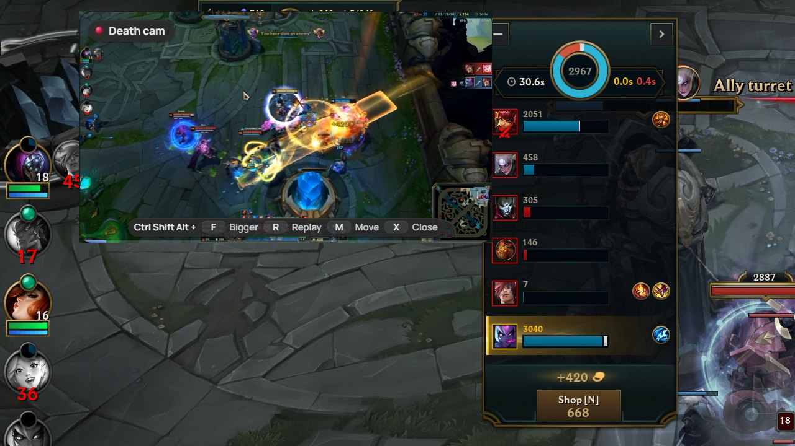
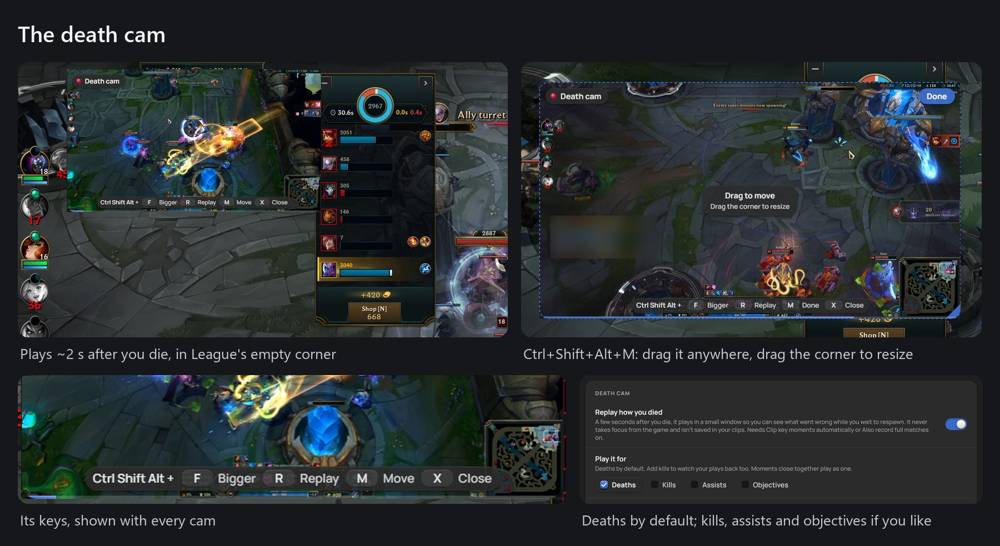
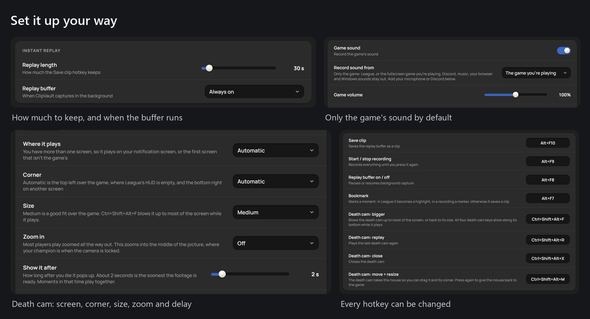
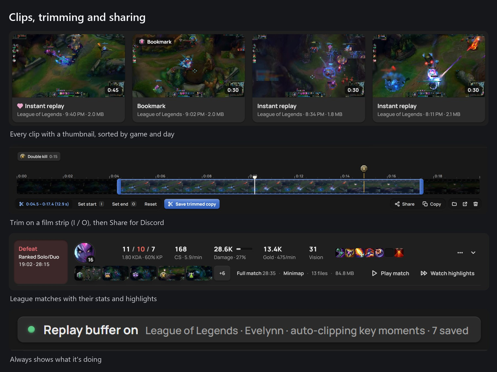
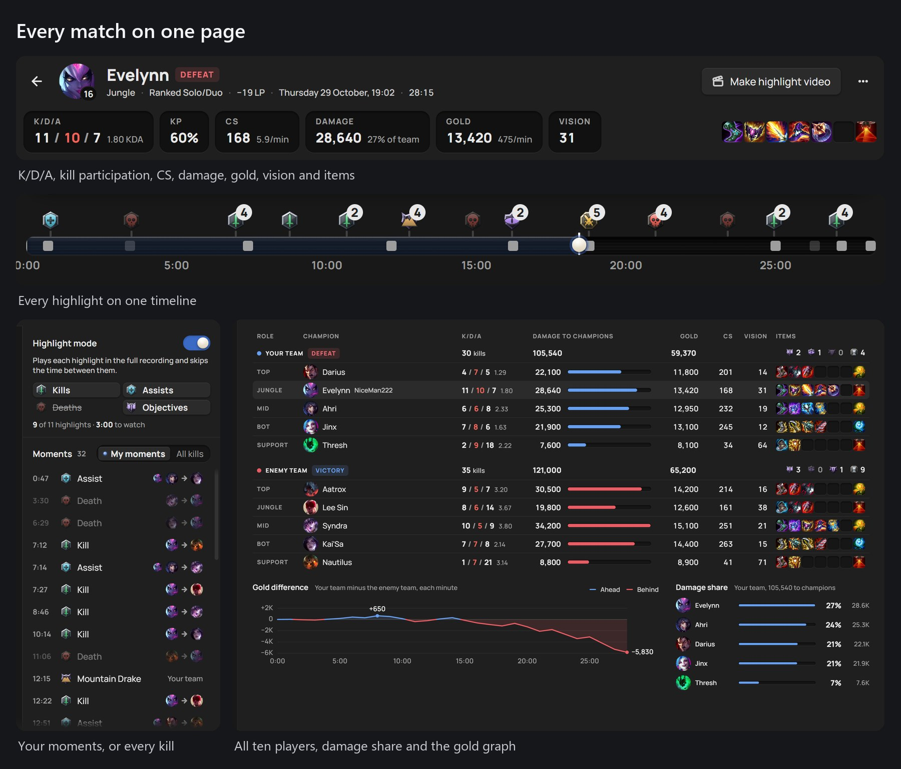
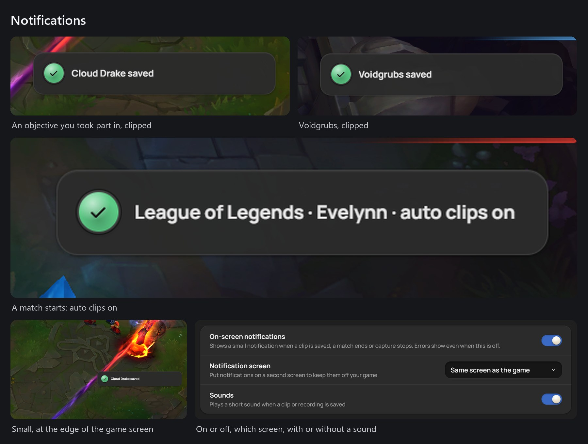

<div align="center">

# ClipVault

**A free, ad-free game recorder for Windows that replays how you died in League of Legends, while you wait to respawn.**

[**⬇ Download the installer**](https://github.com/arpan2711/clipvault-public/releases/latest) · [**⬇ Portable zip**](https://github.com/arpan2711/clipvault-public/releases/latest) · [User guide](docs/GUIDE.md) · [Report a bug](https://github.com/arpan2711/clipvault-public/issues) · [Code signing policy](docs/CODE_SIGNING.md) · [**☕ Support it**](https://ko-fi.com/arpanmitra)

[](https://github.com/arpan2711/clipvault-public/releases/latest)
[](https://github.com/arpan2711/clipvault-public/releases)

[](LICENSE)




<sub>The death cam, about two seconds after a death: the fight plays back in League's empty top-left corner. The keys underneath make it bigger, replay it, move it or close it.</sub>

</div>

---

ClipVault started because I wanted an Insights Capture / ShadowPlay-style recorder with no ads, no account and no overlay store. It also had to show me *why* I just died. It keeps the last 30 seconds of your game in the background, saves a clip with one key, and in League it clips your kills, deaths and objectives for you. Then it puts every match on one page with your stats.

It's a hobby project by one developer, made with a lot of help from an AI coding assistant. It's free, open source (MIT) and will stay free. If something breaks, [tell me](#reporting-bugs). If it's useful to you, you can [buy me a coffee](https://ko-fi.com/arpanmitra).

## Why ClipVault

- **Free, and no ads.** No premium tier, no watermark, no "upgrade" buttons.
- **No account.** Install it and play. Nothing to sign up for.
- **Local only.** Clips stay in `Videos\ClipVault` on your PC. Nothing is uploaded, and there's no telemetry or tracking (see the [FAQ](#does-it-upload-anything)).
- **Light on your PC.** It records with your graphics card's video encoder (NVIDIA NVENC, AMD AMF or Intel Quick Sync). At native resolution the picture never leaves the GPU, and saving a clip just joins the last few seconds of footage without re-encoding it.
- **Made for League.** It reads Riot's official game data, not memory, and gives you the death cam, auto-clips, match pages and a match reel.

## Features

### The death cam



About **2 seconds after you die**, a small picture-in-picture replay of the fight plays in League's empty top-left corner. You can see what went wrong while the respawn timer runs.
- It never takes focus from the game. Over the game, clicks go straight through to League.
- It isn't saved in your clips.
- If you have a second screen, it plays there instead (you can change that).

| Hotkey | What it does |
|---|---|
| **Ctrl+Shift+Alt+F** | Bigger: blows the cam up to 75 % of the screen (press again for smaller) |
| **Ctrl+Shift+Alt+R** | Replay the last death cam |
| **Ctrl+Shift+Alt+M** | Move + resize: drag it anywhere, drag the blue corner to resize, then click **Done** or press M again |
| **Ctrl+Shift+Alt+X** | Close it |

The keys are shown in a strip under the cam, so you don't have to remember them. They use three modifiers on purpose: League doesn't use any of them.

In **Settings → League of Legends → Death cam** you choose:
- what it plays for: **deaths** by default; kills, assists and objectives are optional;
- how long after the moment it appears (1–10 s, default 2);
- how much it shows before the moment (default 8 s);
- the zoom (off, 1.25×, 1.5×, 2×);
- the size (small to extra large), the screen and the corner.

**Try it** plays one from the replay buffer without dying. **Reset** puts a moved cam back.



### Instant replay

The replay buffer quietly keeps the last **30 seconds** (adjustable from 10 s to 5 min).
- **Alt+F10** saves it as a clip, in about a second.
- **Alt+F8** turns the buffer on or off.
- The buffer can be **always on**, **only on while a fullscreen game runs**, or **manual**.

### Full recordings and bookmarks

- **Alt+F9** starts and stops a full recording.
- **Alt+F7** drops a bookmark:
  - in a League match, the moment becomes a highlight;
  - during a recording, it's a marker on the timeline;
  - otherwise, it saves a clip with the moment marked.

### A clip library with an editor



- Clips are sorted by game and day, with thumbnails, search and favourites.
- The player has a **trimmer** (film strip, **I** / **O** to set start and end), speed control (0.25–2×) and frame stepping. Press **?** for every shortcut.
- **Share** makes a copy under 10 / 25 / 50 / 100 / 500 MB (Discord's limits) and puts it on the clipboard. **Copy** puts the file itself there, or you can drag a clip straight into Discord.
- **Merge** several clips into one video (Ctrl+click or Shift+click to select).
- An optional **storage limit** sends the oldest videos to the Recycle Bin. Favourites are never removed.


### Game-only audio


By default ClipVault records **only the game's sound**: League, or the fullscreen game you're playing. Discord, Spotify, your browser and Windows sounds stay out of your clips. You can add:
- your **microphone** (always on, or push-to-talk on a key or a mouse side button);
- **Discord voice**, with its own volume;
- **separate audio tracks** for game, mic and Discord, so you can pick one later.

### And the small things

- **Notifications:** a small on-screen toast and a sound when something is saved. You can move them to your second screen or turn them off.
- **Hotkeys that work in League:** League blocks normal global hotkeys while it's in front, so during a match ClipVault also listens for your hotkeys itself (see the [FAQ](#why-does-antivirus-flag-cvhelperexe-does-it-read-my-keyboard)).
- **Capture recovery:** if Windows stops handing out frames (after sleep, a driver hiccup, a fullscreen switch), ClipVault notices within a few seconds and restarts capture, keeping the footage from before. It keeps retrying until it's back.
- **Update check:** at start and once a day it asks GitHub Releases whether there's a new version and tells you. It never installs anything by itself, and you can turn it off.
- **Bug reports from inside the app:** see [Reporting bugs](#reporting-bugs).
- **Themes:** Gray, Midnight blue and Light. It sits in the tray, can start with Windows, and can be controlled from the command line (Stream Deck friendly).

## League of Legends



There's nothing to set up: start a game and ClipVault notices it.

- **Auto-clips:**
  - your kills, multikills, first blood, aces, deaths and assists;
  - the dragons, Barons, Heralds, Voidgrubs and Atakhans you took part in (steals too);
  - the win or loss.

  Each one is clipped from the buffer with 15 s before and 5 s after. Moments less than 20 s apart become one clip, so a teamfight stays together. All of these numbers can be changed.
- **Match pages:**
  - your K/D/A, kill participation, CS, damage and share of your team's damage, gold, vision and items;
  - a full **scoreboard** of all ten players, a gold-difference graph and damage share;
  - every highlight on one timeline.
- **The match reel:**
  - the match page opens by itself when the game closes, in highlight mode;
  - **Make highlight video** joins the match's highlights into one video.
- **The minimap** is recorded for every match (about 40 MB a game) and plays in sync beside each highlight.
- **Full matches** (optional): records the whole game with every key moment marked.




## Download and install

1. Go to **[Releases](https://github.com/arpan2711/clipvault-public/releases/latest)** and download `ClipVault-Setup-<version>.exe` (or the portable `ClipVault-<version>-win-x64.zip`).
2. Run it. The installer is per user (no admin needed), adds Desktop and Start Menu shortcuts, and can be removed from *Apps & features*. The zip needs no install: unzip it anywhere and run `ClipVault.exe`. **Windows SmartScreen** will probably say *"Windows protected your PC"*. Click **More info → Run anyway**.

   > **Why the warning?** ClipVault isn't code-signed yet. I've applied for free code signing for open-source projects from the [SignPath Foundation](https://signpath.org); until that's through, SmartScreen warns about it like every new unsigned app. The source is all here, and every release is built from it by [GitHub Actions](.github/workflows/release.yml), so you can check what you're running. See the [code signing policy](docs/CODE_SIGNING.md).
3. ClipVault opens. Closing the window keeps it running in the tray (bottom-right, by the clock); quit from the tray menu.

**Requirements:** Windows 10 or 11, 64-bit. A recent NVIDIA, AMD or Intel GPU is recommended for hardware encoding; it falls back to the CPU otherwise.

## Quick start

1. **Open ClipVault.** The replay buffer starts by itself. The status at the top says *Replay buffer on · Keeping the last 30 s*.
2. **Play.** When something good happens, press **Alt+F10**. A notification says *Clip saved*. In League, highlights save themselves, and the death cam pops up when you die.
3. **Watch and share.** Open ClipVault from the tray. Your clip is under **Clips** (League games are under **Matches**). Trim it, then press **Share** and paste it into Discord.

## Default hotkeys

All of them can be changed in **Settings → Hotkeys**.

| Hotkey | Action |
|---|---|
| **Alt+F10** | Save clip (the last 30 s) |
| **Alt+F9** | Start / stop a full recording |
| **Alt+F8** | Replay buffer on / off |
| **Alt+F7** | Bookmark the moment |
| **Ctrl+Shift+Alt+F** | Death cam: bigger / smaller |
| **Ctrl+Shift+Alt+R** | Death cam: replay the last one |
| **Ctrl+Shift+Alt+M** | Death cam: move + resize |
| **Ctrl+Shift+Alt+X** | Death cam: close |

> The NVIDIA overlay uses Alt+F9 / Alt+F10 by default too. If a hotkey shows an error in Settings, change it there or turn off NVIDIA Instant Replay.

## FAQ

### Is it allowed by Riot? Can it get me banned?

ClipVault only uses what Riot provides for tools like this. It doesn't read game memory, inject anything or change the game.
- **The Live Client Data API** (`https://127.0.0.1:2999/liveclientdata`). The game itself serves this local, read-only API to every program on your PC. It's where the kills, deaths and objectives come from. Overlay-based recorders get their League events from the same data.
- **The League client's local API, read-only, after the game.** It asks for the end-of-game stats, LP and match history behind the match page. Only GET requests, only a fixed list of endpoints, only on your own PC.
- **The screen**, recorded the way any recorder or streaming app does.

It doesn't touch Vanguard. That said, this is my reading of the rules, not a statement from Riot.

### Does it upload anything?

No. Your clips, recordings, stats and logs stay on your PC. ClipVault goes online only for these:
- **Champion, item, rune and spell icons**, from Riot's Data Dragon and CommunityDragon. They're downloaded once and cached.
- **The update check**: one request at start and once a day to GitHub's public Releases API. You can turn it off in Settings → About.
- **Bug reports**, only when you click *Open on GitHub*. That opens your browser with the report for you to read and send.

There's no telemetry, no analytics and no account.

### How much does it cost in performance?

Very little on a machine with a hardware encoder. Capture uses Windows Desktop Duplication, and at native resolution the frames stay on the GPU, so the cost is mostly the encoder chip, which games don't use. Downscaling (e.g. 1440p → 1080p) uses some CPU.
- Disk use for the buffer is small, because only the last few seconds are kept.

If you see an FPS hit, try a lower frame rate or quality in Settings → Recording, and tell me your GPU.

### Why does antivirus flag `cvhelper.exe`? Does it read my keyboard?

`cvhelper.exe` is ClipVault's small Windows helper, compiled from [`helper/cvhelper.cs`](helper/cvhelper.cs) in this repo. It:
- captures game, microphone and Discord audio;
- tells ClipVault which game is in front;
- during a League match, reads key presses through Windows Raw Input. League switches off normal global hotkeys while it's in front, so this is how Alt+F10 and the death cam keys still work in game. Push-to-talk and the optional key-press overlay use the same helper.

What it reads, and what it never does:
- It **only listens**. It never blocks or sends input.
- It **only reports presses while League is in front**, and **skips the chat**: everything between Enter and Enter/Esc.
- The hotkey listener keeps nothing. The optional *Track keyboard and mouse* feature (off by default) saves presses next to your clips, on your PC only.

A program that reads keys, records audio and isn't signed looks a lot like spyware to a heuristic scanner. That's why some antivirus apps flag it. It's a false positive: you can read the source, and every release is built from it.
- If your antivirus quarantines it, restore it and add an exception for the ClipVault folder.
- Please also [report the false positive](#reporting-bugs) with the antivirus name, so I can send it to the vendor.

### The death cam doesn't show over my game

- It shows over League only in **Borderless** or **Windowed** mode, not exclusive **Fullscreen**.
- It needs the replay buffer. League matches turn the buffer on automatically.
- If you have two screens, it plays on the other one by default. Change that in Settings → Death cam → *Where it plays*.

### Where are my clips and logs?

- Clips: `Videos\ClipVault\<Game>\`.
- Settings and logs: `%APPDATA%\ClipVault`. `clipvault.log` is the app log, and `league-last-match.log` holds the raw events of your last League match.

## Reporting bugs

The easiest way is in the app:
1. Open **Settings → About → Report a bug…**, the tray menu → *Report a bug…*, or the link at the bottom of the sidebar.
2. Describe what happened and, optionally, what you did just before.
3. Leave *Include diagnostics* on to add your Windows version, GPU, encoder and settings plus the last log lines. *What's included* shows exactly what will be sent.
   - Your Windows user name, the League names you play as, and anything that looks like a Riot ID or an email address are removed first.
4. **Open on GitHub** opens a prefilled issue for you to check and submit. You need a free GitHub account. **Save report file** writes the same text to a file instead.


You can also [open an issue](https://github.com/arpan2711/clipvault-public/issues/new) directly.

## Build from source

You need Windows 10/11, [Node.js](https://nodejs.org) 18 or newer, and git.

```
git clone https://github.com/arpan2711/clipvault-public.git
cd clipvault-public
npm install
npm start
```

`npm install` also runs `setup.js`, which:
- downloads FFmpeg (the gyan.dev "essentials" build) into `bin\`;
- compiles `bin\cvhelper.exe` from `helper\cvhelper.cs` with the C# compiler that ships with Windows (.NET Framework 4's `csc.exe`);
- adds **ClipVault** shortcuts to the Desktop and Start Menu.

Run `npm run setup` to redo just that step. `npm test` runs the test suite, and `npm run dist` builds the installer and the portable zip into `dist\`.

Running it again with a flag controls the running instance (handy for Stream Deck or macro keys):

```
npm start -- --save-clip
npm start -- --toggle-recording
npm start -- --toggle-buffer
npm start -- --bookmark
```

## License

ClipVault is [MIT licensed](LICENSE). It uses FFmpeg (GPL), Electron and other open-source parts; see [THIRD-PARTY-NOTICES.md](THIRD-PARTY-NOTICES.md).

---

<sub>ClipVault isn't endorsed by Riot Games and doesn't reflect the views or opinions of Riot Games or anyone officially involved in producing or managing Riot Games properties. Riot Games, and all associated properties are trademarks or registered trademarks of Riot Games, Inc.</sub>
