# ClipVault user guide

This covers every feature and every setting, with a quick way to try each one. The pictures live in `docs/images/`.

**Contents:**
1. [Getting started](#1-getting-started)
2. [Recording and the replay buffer](#2-recording-and-the-replay-buffer)
3. [Saving clips](#3-saving-clips)
4. [Library and editing](#4-library-and-editing)
5. [League of Legends matches](#5-league-of-legends-matches)
6. [The death cam](#6-the-death-cam)
7. [Notifications](#7-notifications)
8. [Audio](#8-audio)
9. [Storage](#9-storage)
10. [Updates, bug reports and troubleshooting](#10-updates-bug-reports-and-troubleshooting)
11. [Every setting at a glance](#11-every-setting-at-a-glance)

---

## 1. Getting started

1. Download ClipVault from [Releases](https://github.com/arpan2711/clipvault-public/releases/latest) and run it.
   - If Windows SmartScreen says *"Windows protected your PC"*, click **More info → Run anyway**. ClipVault isn't code-signed yet; see the README.
2. The ClipVault window opens. Closing it doesn't quit: ClipVault keeps running in the **tray** (the icons by the clock).
   - Click the tray icon to open the window again.
   - Right-click it for the menu: *Save last 30 s*, *Start recording*, *Bookmark this moment*, *Replay buffer* on/off, *Open clips folder*, *Report a bug…*, *Quit ClipVault*.
3. Look at the status at the top of the window. **Replay buffer on · Keeping the last 30 s · <your encoder>** means it's ready.

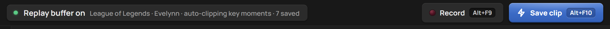

**Settings → General:**
- **Theme:** Gray (default), Midnight blue or Light.
- **Start with Windows:** opens quietly in the tray when you sign in. Off by default.
- **Start minimized:** opens in the tray instead of showing the window. Off by default.

Settings save as soon as you change them. When a change needs it (frame rate, encoder, audio…), capture restarts by itself.

> **Try it:** open Settings → General, switch the theme to Midnight blue and back.

## 2. Recording and the replay buffer

### The replay buffer

ClipVault keeps the last few seconds of your screen (and sound) in a rolling buffer on disk. Nothing becomes a file in your library until you save it.

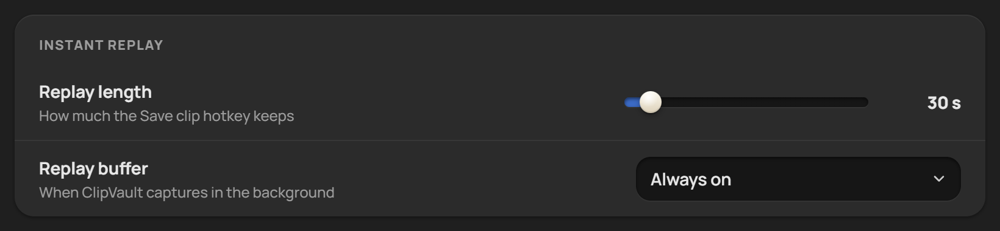

**Settings → Recording → Instant replay:**
- **Replay length:** how much **Save clip** keeps, from 10 s to 5 min. The default is **30 s**.
- **Replay buffer:** when it runs.
  - **Always on** (default): from the moment ClipVault starts.
  - **Only while a fullscreen game runs:** it starts when a fullscreen game comes to the front, and stops two minutes after the game is gone (unless you're recording).
  - **Manual (hotkey or tray):** only when you turn it on.
- **Alt+F8** (or clicking the status, or the tray's *Replay buffer* item) turns it on or off. You'll see *Replay buffer on · keeping the last 30 s* or *Replay buffer off*.
- A League match always turns capture on, even if the buffer was off. That's how auto-clips and the death cam work.

> **Try it:** press **Alt+F8** twice. The status at the top flips between *Replay buffer off* and *Replay buffer on*, and a notification says so each time.

### Full recordings

**Alt+F9** (or the **Record** button) starts a recording of everything until you press it again.
- The button turns into *Recording 0:12* while it runs.
- When you stop, you'll see *Recording saved · <game> · <length>*.
- If the buffer was off, recording turns capture on and then turns it off again afterwards.

### Bookmarks

**Alt+F7** marks a moment. What it does depends on what's happening:
- **In a League match:** the moment becomes a highlight, like a kill would. This needs Settings → League → Moments to clip → *Bookmarks*, which is on by default.
- **During a recording:** a marker on the recording's timeline (*Bookmark added to the recording (1)*).
- **Otherwise:** it saves a clip with the moment marked (labelled *Bookmark*).

> **Try it:** press **Alt+F9**, wait 5 s, press **Alt+F7**, wait, then press **Alt+F9** again. Open the recording: the bookmark is a marker on the timeline.

### Capture settings

**Settings → Recording → Capture:**

| Setting | Choices (default first) | Notes |
|---|---|---|
| Monitor | your screens | Which screen to capture |
| Frame rate | **60**, 30, 120, 144 fps | Higher looks smoother and makes bigger files |
| Resolution | **Native**, 1440p, 1080p, 720p | Native stays on the GPU; downscaling uses some CPU |
| Quality | **High**, Low, Medium, Ultra | Ultra roughly doubles file size |
| Encoder | **Automatic**, NVIDIA NVENC, AMD AMF, Intel Quick Sync, CPU (x264) | Automatic picks your GPU's encoder |
| Video format | **H.264**, H.265 / HEVC | H.265 is about half the size; it needs a GPU encoder; shared copies are always H.264 |
| Show mouse cursor | **On** | |

### Capture auto-recovery

Sometimes Windows stops handing out frames: after the PC wakes from sleep, a driver reset, or a game switching display modes. ClipVault watches for this. If Windows reports a capture error, or no new footage arrives for about 6 seconds, it restarts capture straight away and keeps the footage from before. It also restarts after the PC wakes from sleep.
- If the restart fails, it keeps trying (after 1.5, 5, 10, 20 and 30 s, then every 30 s) until capture is back. You'll see *Capture stopped · ClipVault keeps trying to restart it*, then *Capture restarted*.
- During a full recording, the recording carries on in a new file (*Capture restarted · recording continues in a new file*).
- Each stop and restart is written to the log with the reason (see [Logs](#where-the-logs-are)).

## 3. Saving clips

Press **Alt+F10** in any game, or click **Save clip**. The last 30 seconds become an MP4 in about a second, because the footage is copied rather than re-encoded.
- You'll see *Clip saved · <game> · 30 s* and hear a short sound.
- Clips are named and filed per game: `Videos\ClipVault\<Game>\<Game> 2026-10-29 21-14-03.mp4`. The game is detected from the window in front.
- If the buffer is off, you'll see *Replay buffer is off. Press Alt+F8 to turn it on*.

> **Try it:** open any game (or a browser video), wait 30 s, press **Alt+F10**. The clip appears under **Clips** at the top of *Today*.

You can also trigger these from a Stream Deck or macro key by running ClipVault again with a flag:
- `--save-clip`
- `--toggle-recording`
- `--toggle-buffer`
- `--bookmark`

## 4. Library and editing

### The library

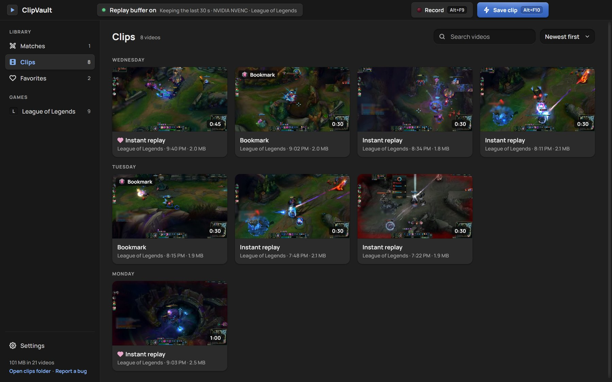

The left side lists:
- **Matches:** your League games, one row each (see section 5).
- **Clips:** everything else, grouped by day (*Today*, *Yesterday*, …). The size and length are on each card.
- **Favorites:** clips you starred.
- **Games:** each game you've recorded, with a count.
- At the bottom: **Settings**, the library size, **Open clips folder** and **Report a bug**.

At the top you can **search** (a game, a champion, a moment such as "Kill", or part of a file name) and **sort**: newest, oldest, longest or largest.

On the cards:
- **Ctrl+click** or **Shift+click** cards to select several. Then you can **merge** them into one video or delete them together.
- Right-click a card for more actions: play, favourite, copy, share, show in folder, delete.

**Deleting:** the video disappears at once, with **Undo** for 5 seconds. After that it goes to the Recycle Bin, never straight to deletion.

### The player and editor

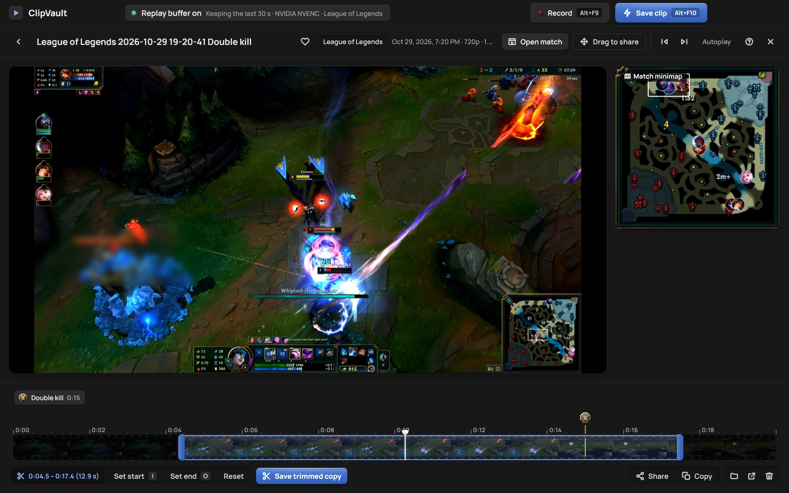

Click a clip to open it. The video controls sit on the video and hide while it plays: seek bar with moments, ±5 s, volume, speed, full screen. Under the video is the **edit bar**:

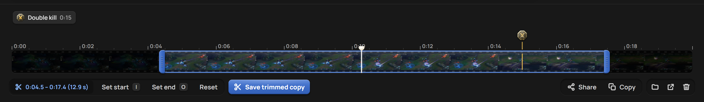

- **Trim:** drag the blue handles on the film strip, or press **I** (set start) and **O** (set end) at the playhead. **Reset** clears it. **Save trimmed copy** writes a new file and leaves the original alone.
- **Share:** makes a copy under a size you pick and puts it on the clipboard, so you can paste it straight into Discord. It only re-encodes when the clip is too big. The sizes:
  - 10 MB (Discord without Nitro)
  - 25 MB (email)
  - 50 MB (Nitro Basic / boosted servers)
  - 100 MB (boost level 3)
  - 500 MB (Nitro)
- **Copy:** puts the file itself on the clipboard. You can also **drag** the clip out of the player into Discord or a folder.
- The **folder**, **open externally** and **delete** icons do what they say.
- ♥ marks the clip as a favourite. Favourites are never removed by the storage limit.
- **Autoplay** and the ◀ ▶ buttons move to the previous / next video.
- With *Separate audio tracks* on, a menu picks which track you hear (Game, Microphone, Discord).

**Keyboard shortcuts** (press **?** in the player for this list):

| Key | Action |
|---|---|
| Space / K | Play or pause |
| ← → / J L | Back / forward 5 seconds |
| , . | Previous / next frame |
| < > | Slower / faster (0.25× to 2×) |
| [ ] | Previous / next key moment |
| ↑ ↓ | Volume |
| M | Mute |
| F | Full screen |
| 0 – 9 | Jump to 0 % … 90 % |
| N P | Next / previous video |
| I O | Set trim start / end |
| Del | Delete the video |
| Esc | Back to the library |

> **Try it:** open a clip, press **I** at 0:05 and **O** at 0:15, then **Save trimmed copy**. A new 10-second clip appears next to the original.

### Virtual clips

If you record full League matches, each highlight is the same footage as part of the full recording, so it's stored twice. Turning off **Settings → Storage → Keep separate highlight files when the full match is recorded** changes that:
- Once the full recording has been checked, highlights play straight from it ("plays from the full recording" on the card), and their own files go to the Recycle Bin. That saves about a third of each match.
- **Favourites always keep their own file.** Favouriting a virtual clip gives it its file back.
- **Free up space → Preview…** does the same for matches you already have. It first shows what would be removed, and only matches whose recording checks out are touched. It can take a while with many matches.

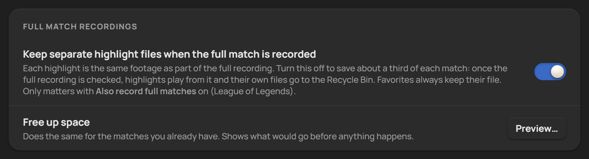

## 5. League of Legends matches

There's nothing to set up. Start a game (any mode, including Practice Tool and bots) and you'll see **League of Legends · <champion> · auto clips on**.

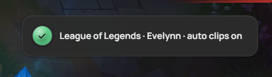

### How it works

While you play, ClipVault reads the game's events from Riot's official **Live Client Data API**, which the game serves on your own PC (`127.0.0.1:2999`). After the game it asks the League client's local API, read-only, for the end-of-game stats and match history. It never reads game memory.

### Auto-clips

The moments that involve you become highlights automatically. Each one shows a short toast (for example *Cloud Drake saved*).

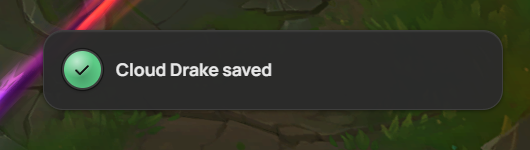

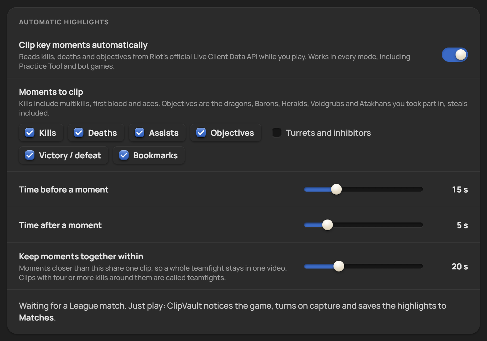

**Settings → League of Legends → Automatic highlights:**
- **Clip key moments automatically:** on by default.
- **Moments to clip:**
  - **Kills** (including multikills, first blood and aces), on
  - **Deaths**, on
  - **Assists**, on
  - **Objectives** (dragons, Barons, Heralds, Voidgrubs and Atakhans you took part in, steals included), on
  - **Turrets and inhibitors**, off
  - **Victory / defeat**, on
  - **Bookmarks**, on
- **Time before a moment:** 15 s (5–45). **Time after a moment:** 5 s (2–20).
- **Keep moments together within:** 20 s (5–60). Moments closer than this share one clip, so kill → kill → double kill becomes one **Double kill** clip. A clip with four or more kills around it that isn't your multikill is called a **Teamfight**.

### The Matches view

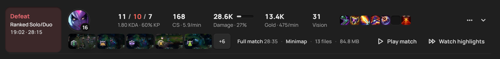

Each match is one row:
- result, queue, time and length;
- your champion, spells and runes;
- K/D/A, CS, damage, gold, vision and items;
- the highlight thumbnails, and **Play match** / **Watch highlights**.

You can filter by result and champion, and search.

### The match page

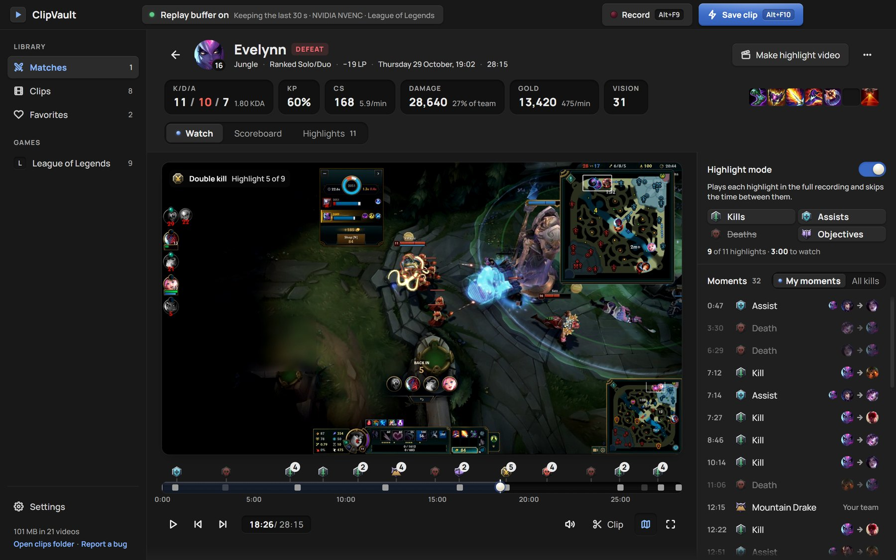

Click a match to open its page.
- **Header:** your champion and level, the result, role, queue, LP change, date and length, then K/D/A, kill participation, CS (per minute), damage (and share of your team), gold (per minute), vision and items. **Make highlight video** is top right.
- **Watch tab:** the full recording, or the highlights in order.
  - The timeline below has an icon for each moment; click one to jump there.
  - **Highlight mode** plays only the highlights and skips the time between them. You pick which kinds: Kills, Assists, Deaths, Objectives.
  - The **Moments** list on the right switches between *My moments* and *All kills* (every kill of the match: ally rows blue, enemy rows red).
  - The **minimap** plays in sync, picture-in-picture.
  - **Clip** opens the player at the playhead. **F** is full screen.
- **Scoreboard tab:** all ten players (role, champion, K/D/A, damage with bars, gold, CS, vision, items), team totals and objectives, a gold-difference graph per minute, and your team's damage share.
- **Highlights tab:** every highlight as a card, filtered by kind (Kills, Deaths, Assists, Objectives, Multikills). **Select** lets you pick some for a highlight video. A line at the bottom says how many files the match uses on disk.

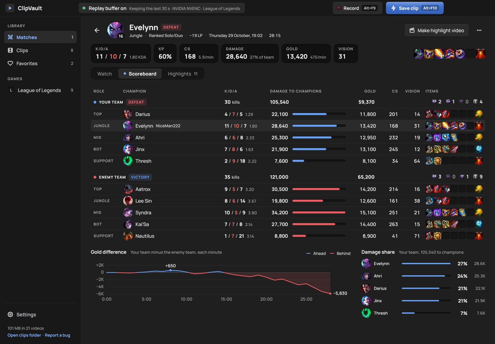

The stats (CS, damage, gold, vision, items, LP, the other nine players) come from the League client after the game. If the client was closed, ClipVault fills them in later, the next time the client is open. Riot's match history keeps games for about three weeks.

### The match reel

When the game closes, the match page opens by itself in highlight mode, so you can watch your game back. Turn this off with **Settings → League → Each match → Open the match when the game closes**.
- **Make highlight video** joins the match's highlights into one video, with overlapping footage shown once.
- At the end of a match you'll see a toast like *Match saved · Defeat · Evelynn 11/10/7* over *28 highlights*.

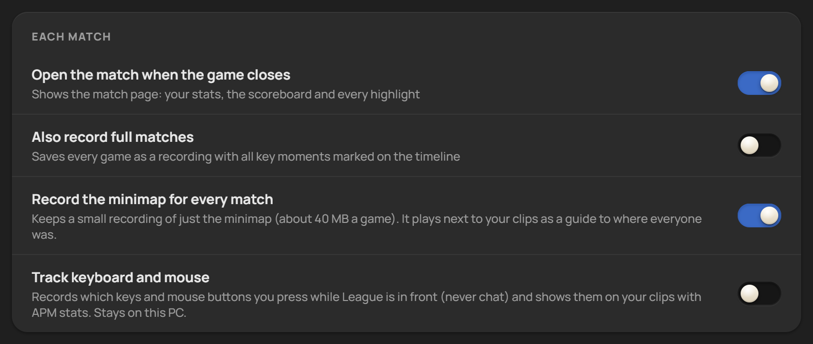

**Settings → League of Legends → Each match:**
- **Open the match when the game closes:** on.
- **Also record full matches:** off. Saves every game as a recording with all key moments marked. Pair it with *virtual clips* (section 4) to save space.
- **Record the minimap for every match:** on. A small recording of just the minimap, about 40 MB a game, that plays next to your clips.
- **Track keyboard and mouse:** off. Records which keys and mouse buttons you press while League is in front (never chat) and shows them on your clips with APM stats. It stays on your PC.

> **Try it:** play a quick bot game (or Practice Tool) and get a kill, or die once. A toast says the highlight was saved, and the death cam plays. Close the game: the match page opens in highlight mode.

## 6. The death cam

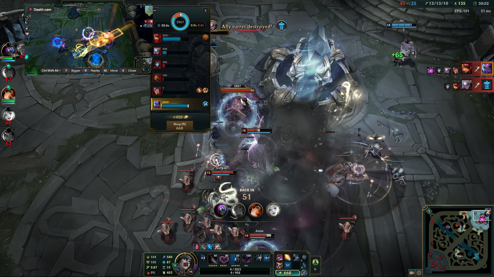

When you die in League, the death cam plays the fight back in a small window about **2 seconds later**, while the respawn timer runs.
- **It never takes focus from the game.** Over the game, mouse clicks go straight through it to League. On a second screen, clicking it closes it.
- **It isn't saved in your clips.** Screen captures can't see it either.
- After the replay ends it holds the last frame for a moment, then fades out (it stays longer when blown up).
- **Deaths close together play as one.** So do the moments in the delay window.

The window's label says what it's showing: **Death cam**, **Kill cam**, or **Replay** (for assists and objectives).

### The hotkeys

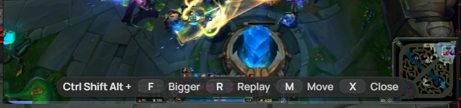

The strip under the cam shows these keys:

| Hotkey | What it does |
|---|---|
| **Ctrl+Shift+Alt+F** | **Bigger:** blows the cam up to 75 % of the screen, centred. Press again for **Smaller**. |
| **Ctrl+Shift+Alt+R** | **Replay:** plays the last death cam again (*No death cam to replay yet* if there isn't one). |
| **Ctrl+Shift+Alt+M** | **Move + resize** (see below). |
| **Ctrl+Shift+Alt+X** | **Close.** |

They use three modifiers so they never clash with League's keys. Change them in **Settings → Hotkeys**.

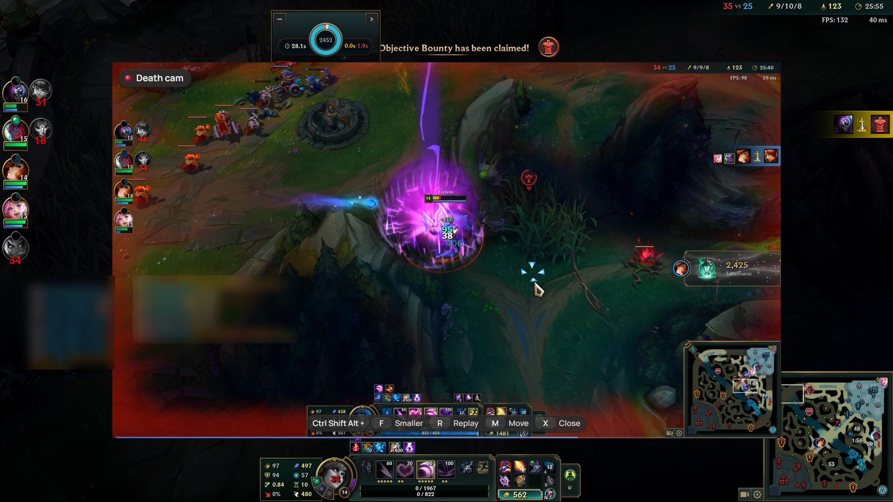

### Moving and resizing it

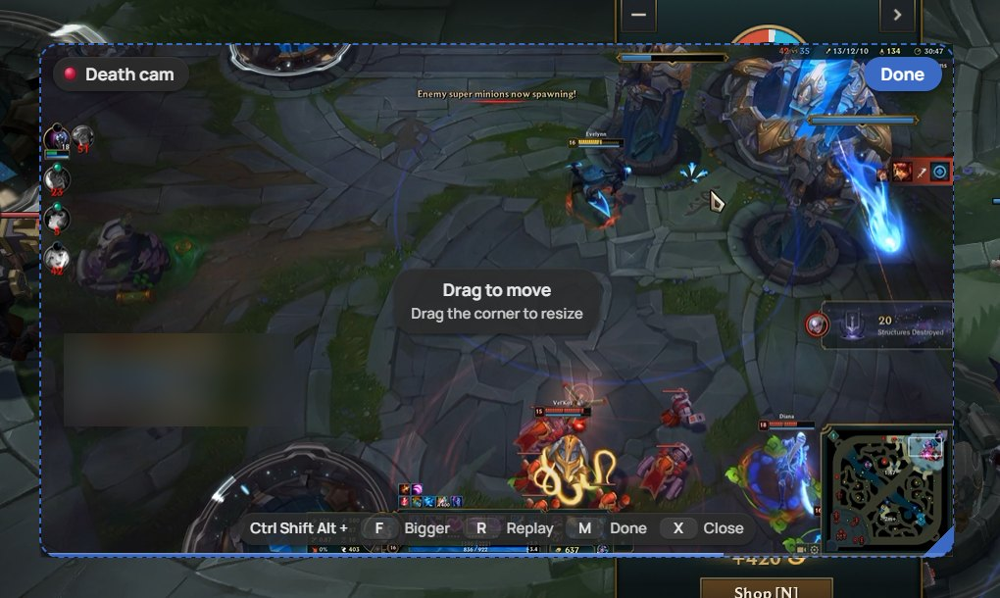

1. Press **Ctrl+Shift+Alt+M** (or click **Settings → League → Death cam → Move or resize**).
   - The cam takes the mouse and stays up, looping the last death, or showing an empty frame if there's none yet.
   - A dashed outline and *Drag to move · Drag the corner to resize* appear.
2. **Drag anywhere on the cam** to move it.
3. **Drag the blue triangle in the bottom-right corner** to resize it. It keeps 16:9 and stays at least 240 px wide.

   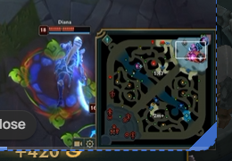
4. Click **Done** (top right of the cam), or press **Ctrl+Shift+Alt+M** again, to give the mouse back to the game.

Where you put it is remembered for that screen. **Settings → Death cam → Reset** (shown once you've moved it) goes back to the Size and Corner settings.

### Settings

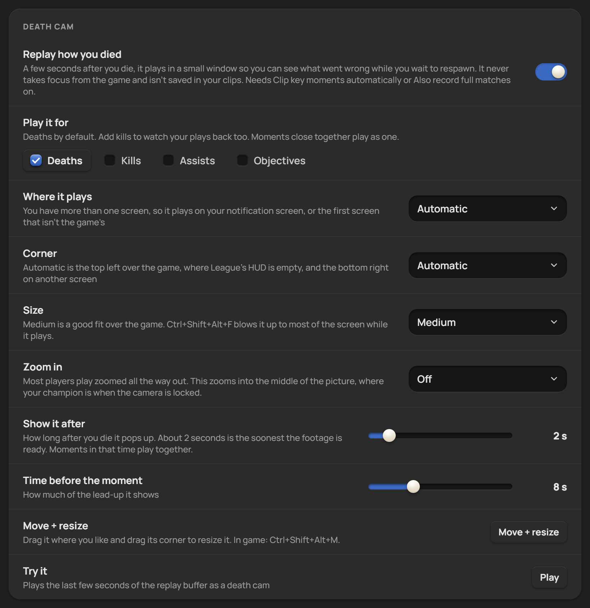

**Settings → League of Legends → Death cam:**

| Setting | Default | Choices |
|---|---|---|
| **Replay how you died** | On | Turns the death cam on or off. It needs the replay buffer, which League matches turn on anyway. |
| **Play it for** | Deaths | Deaths, Kills (incl. multikills, first blood, aces), Assists, Objectives (dragons, Barons, Heralds, Voidgrubs, Atakhans you took part in). Any mix. |
| **Where it plays** | Your other screen when you have one, else the game's screen | Also: *Only your other screen* (off with one screen), *On the game's screen* |
| **Corner** | Automatic | Automatic is the top left over the game (League's emptiest HUD corner) and the bottom right on another screen. Or pick a corner. |
| **Size** | Medium (26 % of the screen width over the game) | Small, Medium, Large, Extra large |
| **Zoom in** | Off | 1.25×, 1.5×, 2×. Zooms into the middle of the picture, where your champion is with the camera locked. Useful if you play zoomed out. |
| **Show it after** | 2 s | 1–10 s after the moment. About 2 s is the soonest the footage is ready. |
| **Time before the moment** | 8 s | 3–20 s of footage before the moment |
| **Move or resize** | – | Same as Ctrl+Shift+Alt+M. **Reset** appears after a move. |
| **Try it** | – | **Play** shows the last few seconds of the replay buffer as a death cam (the buffer must be on) |

**Over the game it only shows in Borderless or Windowed mode.** Exclusive Fullscreen draws over everything. In League: Settings → Video → Window mode → Borderless.

> **Try it, without a game:** turn the buffer on (Alt+F8), wait 10 s, then Settings → League → Death cam → **Try it → Play**. Press **Ctrl+Shift+Alt+F** for bigger, **Ctrl+Shift+Alt+M** to move it, and **Ctrl+Shift+Alt+X** to close it.
>
> **In a game:** a bot game or Practice Tool works. Walk under an enemy tower to die quickly.

## 7. Notifications

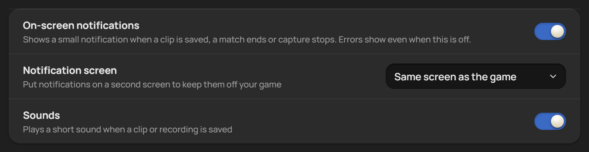

A small notification appears at the right edge of the game's screen, about a third of the way down (below League's kill feed, above the minimap) when:
- a clip, highlight or recording is saved;
- the buffer turns on or off;
- a match starts;
- capture restarts;
- an update is out.

Highlight notifications leave after about 2 seconds. Notifications are hidden from your own recordings. If the ClipVault window is in front, they show inside it instead.

**Settings → Notifications:**
- **On-screen notifications:** on. Turn it off and you get no pop-ups, **except errors**, which always show so you know when something failed.
- **Notification screen:** *Same screen as the game* (default), or any of your screens. On another screen they sit in its top-right corner, off your game.
- **Sounds:** on. A short sound when a clip or recording is saved (and an error sound when something fails).

Like the death cam, notifications can't show over exclusive Fullscreen; use Borderless, or rely on the sound.

## 8. Audio

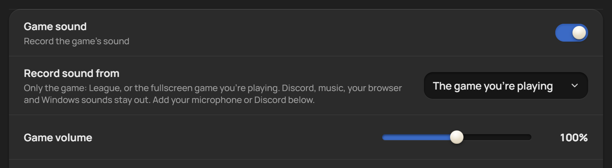

**Settings → Audio:**
- **Game sound:** on.
- **Record sound from:**
  - **The game you're playing** (default): only League, or the fullscreen game in front. Discord, music, your browser and Windows sounds stay out. This uses Windows' per-process audio capture.
  - **Everything you hear**: whatever comes out of your speakers.
- **Game volume:** 0–200 %, 100 % by default.
- **Microphone:** off. When on:
  - **Microphone mode:** *Always on* or *Push-to-talk*.
  - **Push-to-talk key:** a key or a mouse side button (V by default). It still works normally in your game.
  - **Release delay:** 300 ms by default, so the end of a word isn't cut off.
  - **Microphone volume.**
- **Discord voice:** off. Records the Discord app (your friends) with its own volume.
- **Separate audio tracks:** off. Saves Game, Microphone and Discord as extra tracks next to the mixed one. Pick which to hear in the player; Share lets you pick the track for the copy.

## 9. Storage

**Settings → Storage:**
- **Save folder:** `Videos\ClipVault` by default. Each game gets its own folder. **Change…** and **Open** are next to it.
- **Storage limit:** *No limit* (default), or 25 GB … 2 TB. Past the limit, the oldest videos go to the Recycle Bin after each save, with a notification. Favourites are never removed and don't count, and the match you're playing is never touched.
- **Full match recordings → Keep separate highlight files / Free up space:** see [Virtual clips](#virtual-clips).

## 10. Updates, bug reports and troubleshooting

### Updates

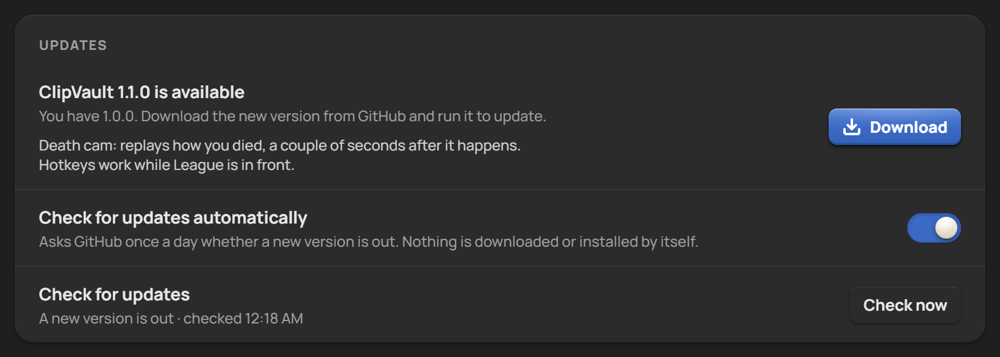

ClipVault checks GitHub Releases 30 seconds after it starts, then once a day.
- When a new version is out, you'll get **one** notification (*ClipVault 1.1.0 is available · Settings → About*). It's never shown during a game.
- **Settings → About** shows the version and its notes, with a **Download** button that opens the release page.
- Nothing is downloaded or installed by itself.
- **Check for updates automatically** turns the daily check off. **Check now** checks right away.

### Reporting a bug

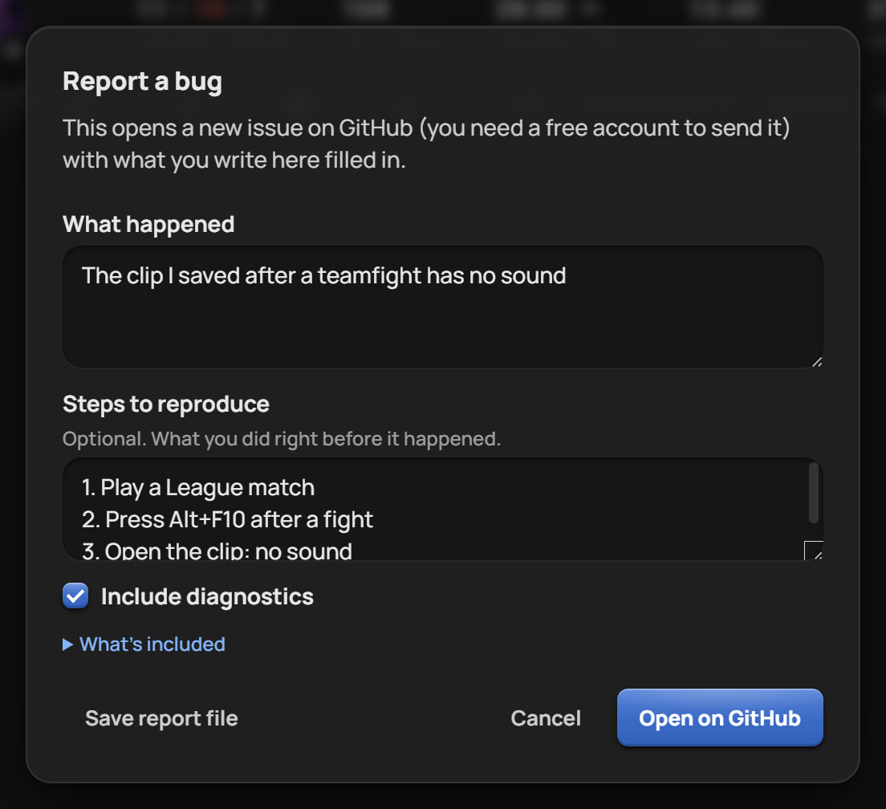

1. Open **Settings → About → Report a bug…**, the tray menu, or **Report a bug** at the bottom of the sidebar.
2. Fill in **What happened**, and optionally **Steps to reproduce**.
3. **Include diagnostics** (on) adds your Windows version, ClipVault/Electron/FFmpeg versions, GPU, encoder, capture method, screens, your settings and the last 200 log lines. *What's included* shows the exact text.
   - Your Windows user name, the League names you play as, Riot IDs and email addresses are removed first.
4. **Open on GitHub** opens a prefilled issue in your browser to check and submit (free GitHub account needed). **Save report file** saves the same text, if you'd rather email it or attach it yourself.

### Troubleshooting

**Capture stopped / "Capture keeps stopping"**
- ClipVault restarts capture by itself (see [auto-recovery](#capture-auto-recovery)). If it keeps failing, the banner shows FFmpeg's error.
- Try another **Encoder** or **Monitor** in Settings → Recording. It falls back to GDI capture and the CPU encoder automatically.
- Settings → About → Diagnostics shows the **Encoder** and **Capture method** in use. *Desktop Duplication (GPU)* is the normal one, *GDI (compatibility)* the fallback.

**Hotkeys don't work in game**
- League switches off normal global hotkeys while it's in front. During a match, ClipVault also reads them from its helper's key stream. If they still don't work:
  - check that `cvhelper.exe` (in the ClipVault folder, under `resources\bin` for the installed app) exists, and that your antivirus didn't quarantine it;
  - look for `hotkey listener` lines in the log.
- In other games: a hotkey that shows an error in **Settings → Hotkeys** is taken by another app. The NVIDIA overlay uses Alt+F9 / Alt+F10 by default. Click the hotkey, press a new combination, or use **Reset to defaults**.

**No notification / no death cam over the game**
- Use Borderless or Windowed mode.
- Check Settings → Notifications → *On-screen notifications*, and Settings → Death cam → *Where it plays*.

**A League moment wasn't clipped**
- Check Settings → League → *Moments to clip*.
- `league-last-match.log` lists every event the game reported and what was clipped.

**Antivirus flags `cvhelper.exe`**
- It's a false positive: an unsigned helper that captures audio and, during League matches, reads key presses for the hotkeys. See the README FAQ. Restore it, and add an exception for the ClipVault folder.

### Where the logs are

Everything is in `%APPDATA%\ClipVault`. Paste that path into Explorer, or click Settings → About → **Log file → Show in folder**.
- `clipvault.log`: starts, quits, capture stops and restarts (with the reason), update checks, errors.
- `league-last-match.log`: the raw events of your last League match and what was clipped.
- `league-logs\`: the same for the last 20 matches.
- `settings.json`: your settings.

Clips are in `Videos\ClipVault` (or your chosen save folder).

## 11. Every setting at a glance

| Section | Setting | Default |
|---|---|---|
| General | Theme | Gray |
| | Start with Windows / Start minimized | Off / Off |
| Recording | Monitor / Frame rate / Resolution / Quality | First screen / 60 fps / Native / High |
| | Encoder / Video format / Show mouse cursor | Automatic / H.264 / On |
| | Replay length / Replay buffer | 30 s / Always on |
| Audio | Game sound / Record sound from / Game volume | On / The game you're playing / 100 % |
| | Microphone (mode, push-to-talk key, release delay, volume) | Off (Always on, V, 300 ms, 100 %) |
| | Discord voice / Separate audio tracks | Off / Off |
| Hotkeys | Save clip / Record / Buffer / Bookmark | Alt+F10 / Alt+F9 / Alt+F8 / Alt+F7 |
| | Death cam: bigger / replay / close / move | Ctrl+Shift+Alt+F / R / X / M |
| League | Clip key moments automatically | On |
| | Moments: kills, deaths, assists, objectives, turrets, victory/defeat, bookmarks | On, on, on, on, **off**, on, on |
| | Time before / after / keep together within | 15 s / 5 s / 20 s |
| | Open the match when the game closes / Record full matches / Minimap / Track keyboard and mouse | On / Off / On / Off |
| Death cam | Replay how you died / Play it for | On / Deaths |
| | Where it plays / Corner / Size / Zoom | Other screen if any / Automatic / Medium / Off |
| | Show it after / Time before the moment | 2 s / 8 s |
| Storage | Save folder / Storage limit | Videos\ClipVault / No limit |
| | Keep separate highlight files | On |
| Notifications | On-screen notifications / Notification screen / Sounds | On / Same screen as the game / On |
| About | Check for updates automatically | On |
